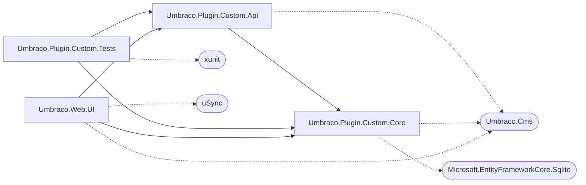

# Sơ đồ project ANTC Portal

> File này **tự sinh** bằng `python docs/so-do/gen_so_do.py`. Đừng sửa tay; chạy lại script sau khi đổi cấu trúc.
> GitLab/GitHub/VS Code (Markdown Preview Mermaid) tự vẽ các khối Mermaid bên dưới.

## 1. Quan hệ giữa các project .NET

## 2. Document type dạng trang (uSync)

Mũi tên liền = được phép tạo con; nét đứt = composition hoặc template.

```mermaid
graph TD
  antc["An toàn tài chính<br/><i>antc</i>"]
  article["Bài viết<br/><i>article</i>"]
  articleList["Danh mục bài viết<br/><i>articleList</i>"]
  articleManagement["Kho Thủ đoạn<br/><i>articleManagement</i>"]
  chinhSachPage["Trang Chính sách<br/><i>chinhSachPage</i>"]
  contentManagement["Quản lý nội dung<br/><i>contentManagement</i>"]
  hoiDapPage["Trang Hỏi – Đáp<br/><i>hoiDapPage</i>"]
  home["Trang chủ (Giới thiệu)<br/><i>home</i>"]
  pageManagement["Quản lý trang<br/><i>pageManagement</i>"]
  qaItem["Câu trả lời công khai<br/><i>qaItem</i>"]
  searchPage["Trang Tìm kiếm<br/><i>searchPage</i>"]
  seoBase["SEO dùng chung<br/><i>seoBase</i>"]
  thamGiaPage["Trang Tham gia<br/><i>thamGiaPage</i>"]
  thiPage["Trang Cuộc thi<br/><i>thiPage</i>"]
  thiThangPage["Trang Cuộc thi tháng<br/><i>thiThangPage</i>"]
  thiThuPage["Trang Thử sức<br/><i>thiThuPage</i>"]
  thuDoanPage["Trang Thủ đoạn<br/><i>thuDoanPage</i>"]
  ungPhoPage["Trang Ứng phó khẩn cấp<br/><i>ungPhoPage</i>"]
  antc --> pageManagement
  antc --> contentManagement
  article -. composition .-> seoBase
  article -.-> tpl_article{{"article.cshtml"}}
  articleList --> article
  articleList -. composition .-> seoBase
  articleList -.-> tpl_articleList{{"articleList.cshtml"}}
  articleManagement --> articleList
  chinhSachPage -. composition .-> seoBase
  chinhSachPage -.-> tpl_chinhSachPage{{"chinhSachPage.cshtml"}}
  contentManagement --> articleManagement
  contentManagement --> articleList
  hoiDapPage -. composition .-> seoBase
  hoiDapPage -.-> tpl_hoiDapPage{{"hoiDapPage.cshtml"}}
  home --> ungPhoPage
  home --> thuDoanPage
  home --> thamGiaPage
  home --> thiThuPage
  home --> thiPage
  home --> hoiDapPage
  home --> chinhSachPage
  home --> searchPage
  home --> thiThangPage
  home -. composition .-> seoBase
  home -.-> tpl_home{{"home.cshtml"}}
  pageManagement --> home
  qaItem -. composition .-> seoBase
  searchPage -. composition .-> seoBase
  searchPage -.-> tpl_searchPage{{"searchPage.cshtml"}}
  thamGiaPage -. composition .-> seoBase
  thamGiaPage -.-> tpl_thamGiaPage{{"thamGiaPage.cshtml"}}
  thiPage -. composition .-> seoBase
  thiPage -.-> tpl_thiPage{{"thiPage.cshtml"}}
  thiThangPage -. composition .-> seoBase
  thiThangPage -.-> tpl_thiThangPage{{"thiThangPage.cshtml"}}
  thiThuPage -. composition .-> seoBase
  thiThuPage -.-> tpl_thiThuPage{{"thiThuPage.cshtml"}}
  thuDoanPage -. composition .-> seoBase
  thuDoanPage -.-> tpl_thuDoanPage{{"thuDoanPage.cshtml"}}
  ungPhoPage -. composition .-> seoBase
  ungPhoPage -.-> tpl_ungPhoPage{{"ungPhoPage.cshtml"}}
```

## 3. Element type (block dùng trong trang)

Tổng 61 element type.

| Nhóm | Số | Element type |
|---|---|---|
| competition | 11 | competitionAuthenticityBlock, competitionFeedbackBlock, competitionHeroBlock, competitionOverviewBlock, competitionParticipationBlock, competitionPrizeItemBlock, competitionPrizesBlock, competitionPromoBlock, competitionReminderBlock, competitionResultsBlock, competitionScheduleBlock |
| emergency | 10 | emergencyAnswerBlock, emergencyContactItemBlock, emergencyContactsBlock, emergencyHeroBlock, emergencyNumberItem, emergencyQuestionBlock, emergencyQuestionnaireBlock, emergencyScenarioBlock, emergencySituationGroupBlock, emergencySituationSelectorBlock |
| fraud | 6 | fraudAlertsBlock, fraudCategoriesBlock, fraudHeroBlock, fraudMethodItemBlock, fraudMethodsBlock, fraudObjectivesBlock |
| qa | 5 | qaGuidelinesBlock, qaHeroBlock, qaProcessBlock, qaPublishedAnswersBlock, qaSubmissionBlock |
| website | 4 | websiteCheckBlock, websiteHotspotBlock, websiteQuizBlock, websiteQuizOptionBlock |
| practice | 3 | practiceAnswerBlock, practiceQuestionBlock, practiceQuizBlock |
| site | 3 | siteNavigationItem, sitePolicyLinkItem, siteSectionsBlock |
| faq | 2 | faqBlock, faqItemBlock |
| intro | 2 | introHeroBlock, introStoryBlock |
| warning | 2 | warningSignItemBlock, warningSignsBlock |
| information | 1 | informationItemBlock |
| monthly | 1 | monthlyCompetitionHeroBlock |
| navigation | 1 | navigationItemBlock |
| next | 1 | nextSectionBlock |
| official | 1 | officialContactsBlock |
| one | 1 | oneColumnLayoutBlock |
| reading | 1 | readingCollectionsBlock |
| safety | 1 | safetyReminderBlock |
| section | 1 | sectionSettingsBlock |
| self | 1 | selfVerificationBlock |
| share | 1 | shareWebsiteBlock |
| story | 1 | storyChapterBlock |
| two | 1 | twoColumnLayoutBlock |

## 4. Cây nội dung mẫu (37 node)

```mermaid
graph LR
  n068471f0_605e_57ee_b164_547aee46bc79["An toàn tài chính<br/><i>antc</i>"]
  n437e3947_4f08_52e1_baee_75907a540fac["Quản lý trang<br/><i>pageManagement</i>"]
  nd660b5ab_7cd1_48b5_b6e1_1ab56b8218cd["Trang chủ<br/><i>home</i>"]
  n56e74727_59ec_4225_b2ce_ce853ad893ca["Ứng phó khẩn cấp<br/><i>ungPhoPage</i>"]
  nd660b5ab_7cd1_48b5_b6e1_1ab56b8218cd --> n56e74727_59ec_4225_b2ce_ce853ad893ca
  n9ba61825_fa98_4e40_b442_772096d614f8["Thủ đoạn<br/><i>thuDoanPage</i>"]
  nd660b5ab_7cd1_48b5_b6e1_1ab56b8218cd --> n9ba61825_fa98_4e40_b442_772096d614f8
  nb94dab90_8dee_4ff4_b934_c1fb7f723c61["Tham gia<br/><i>thamGiaPage</i>"]
  nd660b5ab_7cd1_48b5_b6e1_1ab56b8218cd --> nb94dab90_8dee_4ff4_b934_c1fb7f723c61
  n6661be33_d417_4400_8828_952da9908c86["Thử sức: 8 câu<br/><i>thiThuPage</i>"]
  nd660b5ab_7cd1_48b5_b6e1_1ab56b8218cd --> n6661be33_d417_4400_8828_952da9908c86
  n88abf9ef_fb93_45c5_9cff_4aa76ca6f250["Cuộc thi trực tuyến<br/><i>thiPage</i>"]
  nd660b5ab_7cd1_48b5_b6e1_1ab56b8218cd --> n88abf9ef_fb93_45c5_9cff_4aa76ca6f250
  nb3ce7bf1_aa24_4acf_9bfd_8cd02d8f784e["Hỏi – Đáp<br/><i>hoiDapPage</i>"]
  nd660b5ab_7cd1_48b5_b6e1_1ab56b8218cd --> nb3ce7bf1_aa24_4acf_9bfd_8cd02d8f784e
  n56fa7c6b_f4e1_44be_8200_ec8be7404349["Tìm kiếm<br/><i>searchPage</i>"]
  nd660b5ab_7cd1_48b5_b6e1_1ab56b8218cd --> n56fa7c6b_f4e1_44be_8200_ec8be7404349
  ndc0bff3b_10be_53d5_87dc_d23ea675fd94["Chính sách<br/><i>chinhSachPage</i>"]
  nd660b5ab_7cd1_48b5_b6e1_1ab56b8218cd --> ndc0bff3b_10be_53d5_87dc_d23ea675fd94
  n3ef975f7_186f_5a25_9e0a_dfe100d471d8["Cuộc thi tháng<br/><i>thiThangPage</i>"]
  nd660b5ab_7cd1_48b5_b6e1_1ab56b8218cd --> n3ef975f7_186f_5a25_9e0a_dfe100d471d8
  n437e3947_4f08_52e1_baee_75907a540fac --> nd660b5ab_7cd1_48b5_b6e1_1ab56b8218cd
  n068471f0_605e_57ee_b164_547aee46bc79 --> n437e3947_4f08_52e1_baee_75907a540fac
  n5a1e0af5_bbf2_54ed_a359_bc4716736ea5["Quản lý nội dung<br/><i>contentManagement</i>"]
  n33df5aae_5658_5ea1_8b01_500630acfd60["Thủ đoạn<br/><i>articleManagement</i>"]
  nf9386cdc_74f6_4893_acc8_eba3162cc7c0["Cuộc gọi, tin nhắn, giả mạo<br/><i>articleList</i>"]
  n90ab7780_e72b_4d53_ae5a_147dfb353e03["Bài mẫu: Cuộc gọi, tin nhắn, giả mạo<br/><i>article</i>"]
  nf9386cdc_74f6_4893_acc8_eba3162cc7c0 --> n90ab7780_e72b_4d53_ae5a_147dfb353e03
  n33df5aae_5658_5ea1_8b01_500630acfd60 --> nf9386cdc_74f6_4893_acc8_eba3162cc7c0
  nfd38232c_0847_4379_9ccb_aba5ee852401["Mua bán, đặt cọc<br/><i>articleList</i>"]
  nd8e9bb9f_9494_4ec1_bfb1_8b862a2ddf84["Bài mẫu: Mua bán, đặt cọc<br/><i>article</i>"]
  nfd38232c_0847_4379_9ccb_aba5ee852401 --> nd8e9bb9f_9494_4ec1_bfb1_8b862a2ddf84
  n33df5aae_5658_5ea1_8b01_500630acfd60 --> nfd38232c_0847_4379_9ccb_aba5ee852401
  n9404a4c7_3fa8_4791_9c9e_dd677f5f3d49["Việc làm, làm thêm<br/><i>articleList</i>"]
  nadbb6788_1e56_411e_a493_aa42e457fc63["Bài mẫu: Việc làm, làm thêm<br/><i>article</i>"]
  n9404a4c7_3fa8_4791_9c9e_dd677f5f3d49 --> nadbb6788_1e56_411e_a493_aa42e457fc63
  n33df5aae_5658_5ea1_8b01_500630acfd60 --> n9404a4c7_3fa8_4791_9c9e_dd677f5f3d49
  n928d8fe6_a83a_425c_a71e_419e28d0d3c3["Đầu tư, góp vốn<br/><i>articleList</i>"]
  nba05466b_4f4e_4a74_9d1c_db6d35b27cf3["Bài mẫu: Đầu tư, góp vốn<br/><i>article</i>"]
  n928d8fe6_a83a_425c_a71e_419e28d0d3c3 --> nba05466b_4f4e_4a74_9d1c_db6d35b27cf3
  n33df5aae_5658_5ea1_8b01_500630acfd60 --> n928d8fe6_a83a_425c_a71e_419e28d0d3c3
  n0400f699_d1d5_4ad1_8b76_91722ba48a77["Vay, nợ<br/><i>articleList</i>"]
  n1c05cd5b_9cb3_42ab_8992_18308d3e0332["Bài mẫu: Vay, nợ<br/><i>article</i>"]
  n0400f699_d1d5_4ad1_8b76_91722ba48a77 --> n1c05cd5b_9cb3_42ab_8992_18308d3e0332
  n33df5aae_5658_5ea1_8b01_500630acfd60 --> n0400f699_d1d5_4ad1_8b76_91722ba48a77
  ncbcea9dd_b92a_4d94_9d43_0487077fe916["Hợp đồng, dịch vụ<br/><i>articleList</i>"]
  naf76aeed_93a0_4872_8d27_8f8a4ee64657["Bài mẫu: Hợp đồng, dịch vụ<br/><i>article</i>"]
  ncbcea9dd_b92a_4d94_9d43_0487077fe916 --> naf76aeed_93a0_4872_8d27_8f8a4ee64657
  n33df5aae_5658_5ea1_8b01_500630acfd60 --> ncbcea9dd_b92a_4d94_9d43_0487077fe916
  ncda7084d_12ac_4edf_bbd9_94b53d78cecc["Cảnh báo<br/><i>articleList</i>"]
  n3efa48cc_59f6_4dcf_afc8_ac76442f4135["Ứng dụng giả mạo dịch vụ công dụ người dân cài đặt<br/><i>article</i>"]
  ncda7084d_12ac_4edf_bbd9_94b53d78cecc --> n3efa48cc_59f6_4dcf_afc8_ac76442f4135
  nc2d699ab_57b1_4ded_b55e_5a02c178a556["Mời góp vốn qua ứng dụng cam kết lợi nhuận cố định<br/><i>article</i>"]
  ncda7084d_12ac_4edf_bbd9_94b53d78cecc --> nc2d699ab_57b1_4ded_b55e_5a02c178a556
  n33df5aae_5658_5ea1_8b01_500630acfd60 --> ncda7084d_12ac_4edf_bbd9_94b53d78cecc
  ne2aa83a7_8e13_436b_9569_8de11c44ce4d["Bài đọc theo chuyên đề<br/><i>articleList</i>"]
  n33df5aae_5658_5ea1_8b01_500630acfd60 --> ne2aa83a7_8e13_436b_9569_8de11c44ce4d
  n3ca68856_dc5b_4335_af7d_42addb4e4db6["Lừa đảo: Từ cổ chí kim<br/><i>articleList</i>"]
  n33df5aae_5658_5ea1_8b01_500630acfd60 --> n3ca68856_dc5b_4335_af7d_42addb4e4db6
  n5a1e0af5_bbf2_54ed_a359_bc4716736ea5 --> n33df5aae_5658_5ea1_8b01_500630acfd60
  n2de3a8b9_e4b6_4348_9321_9b979aa1f398["Chính sách<br/><i>articleList</i>"]
  n0193cd20_026f_4a33_8f04_b5bf5fc3c0fc["Tuyên bố miễn trừ trách nhiệm<br/><i>article</i>"]
  n2de3a8b9_e4b6_4348_9321_9b979aa1f398 --> n0193cd20_026f_4a33_8f04_b5bf5fc3c0fc
  n66d90202_dc1e_4396_bed0_4d7c02305283["Chính sách bảo vệ dữ liệu cá nhân<br/><i>article</i>"]
  n2de3a8b9_e4b6_4348_9321_9b979aa1f398 --> n66d90202_dc1e_4396_bed0_4d7c02305283
  n6eed8736_db48_4151_bb71_0fac9635d1aa["Chính sách tài trợ<br/><i>article</i>"]
  n2de3a8b9_e4b6_4348_9321_9b979aa1f398 --> n6eed8736_db48_4151_bb71_0fac9635d1aa
  n1767e333_7dc2_486a_a48b_23b1cbdc86ac["Nguyên tắc dẫn nguồn<br/><i>article</i>"]
  n2de3a8b9_e4b6_4348_9321_9b979aa1f398 --> n1767e333_7dc2_486a_a48b_23b1cbdc86ac
  n7a2fe7ec_f999_46e2_9029_db9943057404["Cách báo lỗi và cải chính<br/><i>article</i>"]
  n2de3a8b9_e4b6_4348_9321_9b979aa1f398 --> n7a2fe7ec_f999_46e2_9029_db9943057404
  n5a1e0af5_bbf2_54ed_a359_bc4716736ea5 --> n2de3a8b9_e4b6_4348_9321_9b979aa1f398
  n068471f0_605e_57ee_b164_547aee46bc79 --> n5a1e0af5_bbf2_54ed_a359_bc4716736ea5
```

## 5. Mã C# tuỳ biến

### Umbraco.Plugin.Custom.Core

| Thư mục | Số file | File |
|---|---|---|
| Administration | 1 | AdministrationAccess |
| Articles | 7 | ArticleContentSource, ArticleHtmlSanitizer, ArticleModels, ArticleQuery, ArticleReviewPolicy, ArticleSchemaMigration, PublishedArticleService |
| Backoffice | 1 | ContestManagementSectionAccessHandler |
| Composers | 1 | CustomCoreComposer |
| Content | 4 | AntcPublicPaths, AntcPublicRouting, PageTreeNotifications, PageTreeRules |
| Contest | 7 | ContestAdminModels, ContestAdminService, ContestEntryService, ContestModels, ContestScheduleService, CurrentContestService, UmbracoContestSettingsProvider |
| Data | 3 | AppDbContext, AppDbInitializer, Entities |
| Questions | 5 | QuestionCsv, QuestionGuidanceLink, QuestionModels, QuestionModerationService, QuestionSubmissionService |
| Quiz | 3 | QuestionBank, QuizAdminModels, QuizAdminService |
| Services | 1 | AppInfoService |

### Umbraco.Plugin.Custom.Api

| Thư mục | Số file | File |
|---|---|---|
| Composers | 1 | CustomApiComposer |
| Controllers | 10 | ContestAdminController, ContestController, LegacyQuestionsAdministrationController, PublishedArticlesController, PublishedQuestionsController, QuestionManagementController, QuestionsController, QuizAdminController, QuizController, SystemController |
| Models | 2 | ContestEntryModels, QuestionModels |
| Validation | 2 | ContestEntryRequestValidator, QuestionRequestValidator |

### Umbraco.Plugin.Custom.Tests

| Thư mục | Số file | File |
|---|---|---|
| (gốc) | 12 | AntcPublicPathsTests, ContestCampaignAdminServiceTests, ContestEntryRequestValidatorTests, ContestEntryServiceTests, ContestScheduleServiceTests, CurrentContestServiceTests, QuestionBankTests, QuestionGuidanceTests, QuestionsControllerTests, QuizAdminServiceTests, QuizControllerTests, Usings |

### API routes

| Controller | Route |
|---|---|
| ContestAdminController | GET api/v1/admin/contest/campaigns, GET api/v1/admin/contest/campaigns/question-tree, GET api/v1/admin/contest/campaigns/{id:long}, POST api/v1/admin/contest/campaigns, PUT api/v1/admin/contest/campaigns/{id:long}, DELETE api/v1/admin/contest/campaigns/{id:long}, GET api/v1/admin/contest/entries, GET api/v1/admin/contest/entries/{id:long}, GET api/v1/admin/contest/draws, GET api/v1/admin/contest/draws/{id:long}, POST api/v1/admin/contest/draws, PUT api/v1/admin/contest/draws/{id:long}, DELETE api/v1/admin/contest/draws/{id:long} |
| ContestController | POST api/v1/contest/entries |
| LegacyQuestionsAdministrationController | GET //quan-tri/hoi-dap |
| PublishedArticlesController | GET api/v1/article-categories, GET api/v1/articles, GET api/v1/articles/{id:guid} |
| PublishedQuestionsController | GET api/v1/questions, GET api/v1/questions/{id:long} |
| QuestionManagementController | POST , GET , GET /{id:long}, PUT /{id:long}, POST /{id:long}/approve, POST /{id:long}/unpublish, GET /export |
| QuestionsController | POST api/v1/questions |
| QuizAdminController | GET api/v1/admin/quiz/topics, GET api/v1/admin/quiz/topics/{id:int}, POST api/v1/admin/quiz/topics, PUT api/v1/admin/quiz/topics/{id:int}, DELETE api/v1/admin/quiz/topics/{id:int}, GET api/v1/admin/quiz/questions, GET api/v1/admin/quiz/questions/{code}, POST api/v1/admin/quiz/questions, PUT api/v1/admin/quiz/questions/{code}, DELETE api/v1/admin/quiz/questions/{code} |
| QuizController | GET api/v1/quiz/topics, GET api/v1/quiz/topics/{topic:int}/questions, GET api/v1/quiz/sample |
| SystemController | GET api/v1/system/info |
